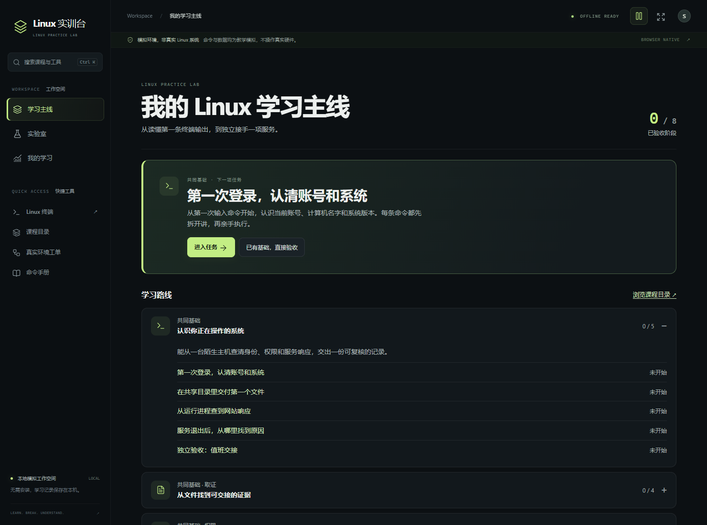
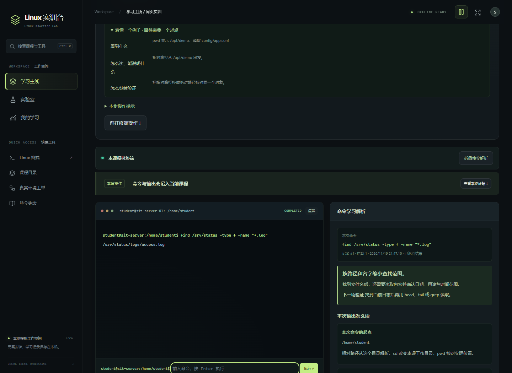
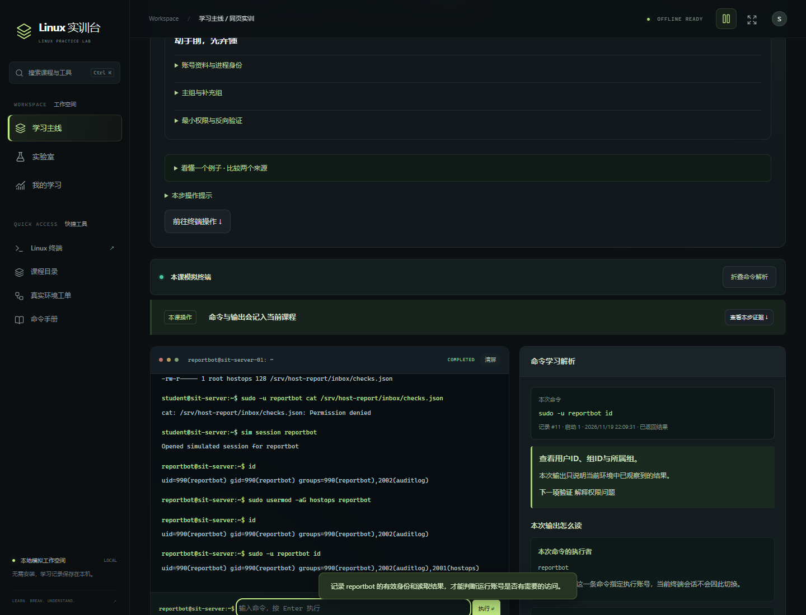
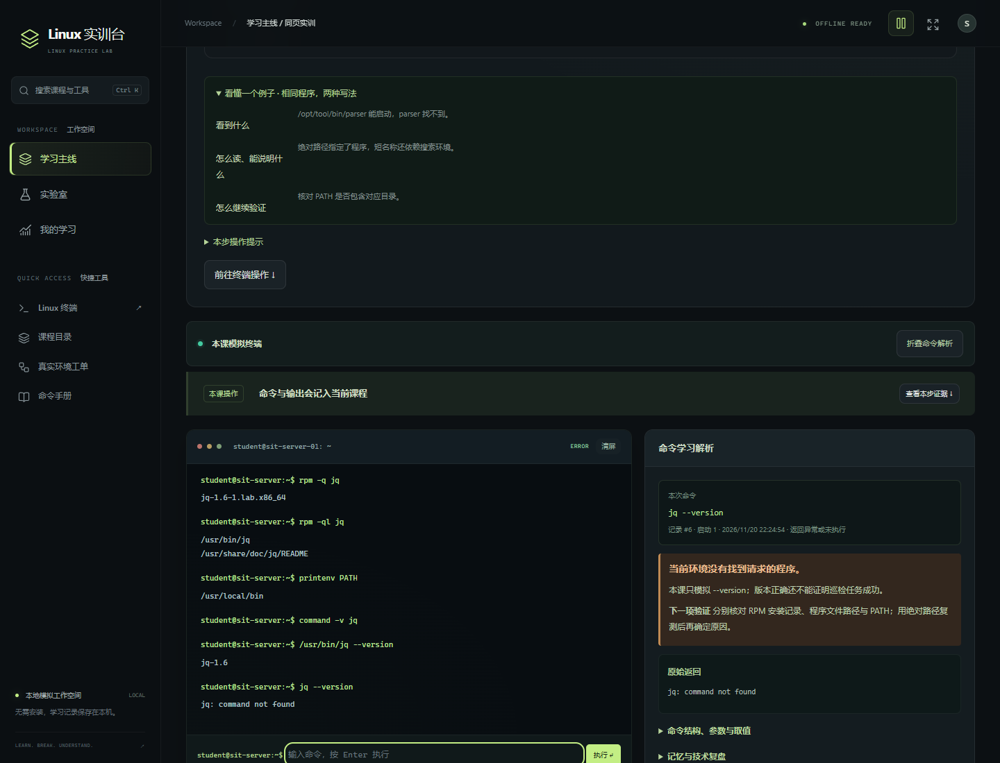
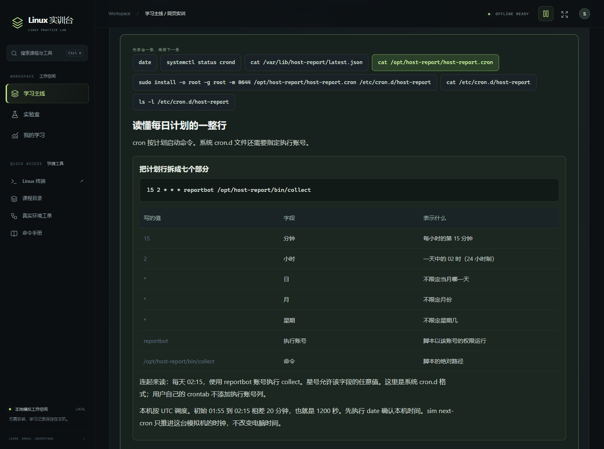
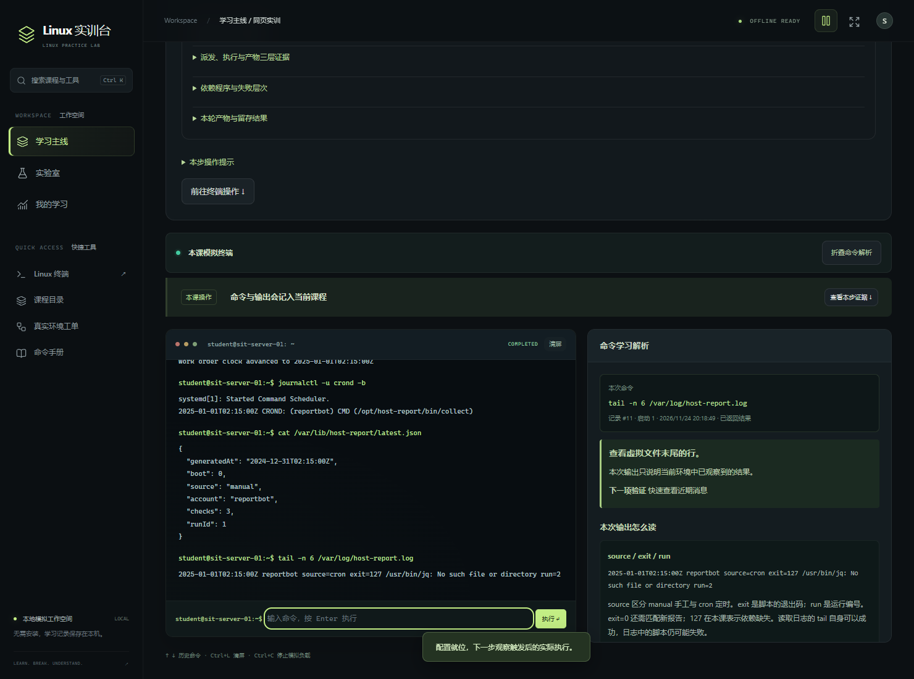
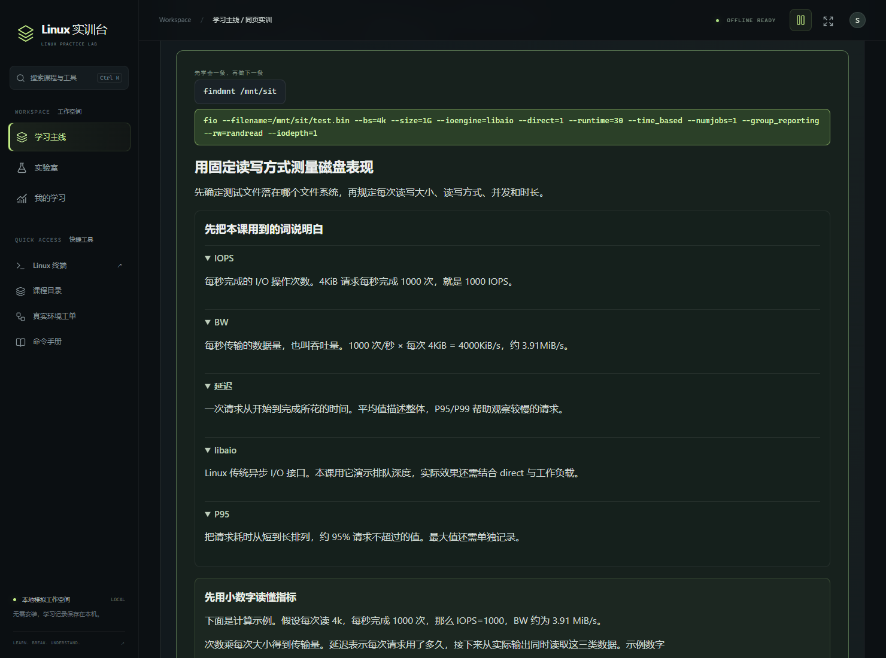
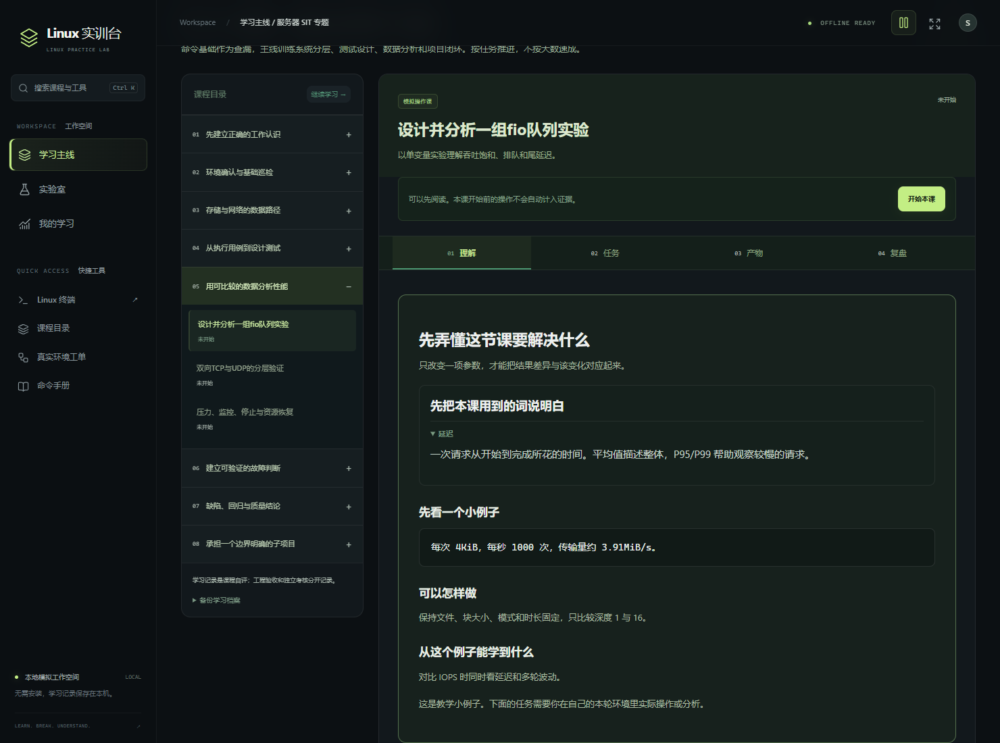
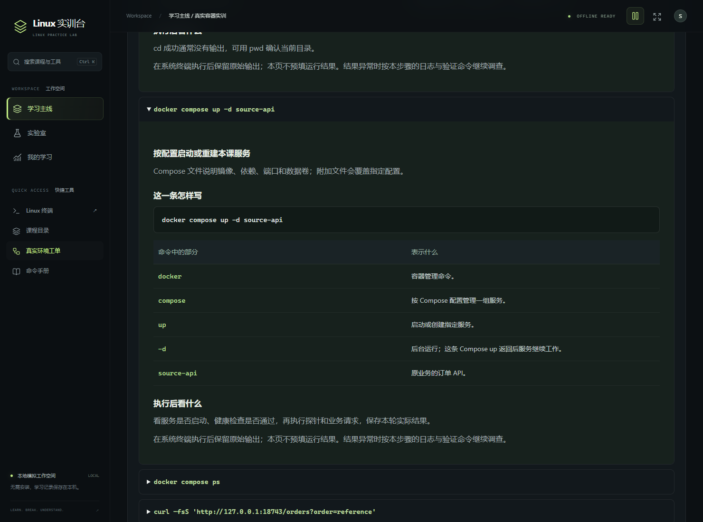
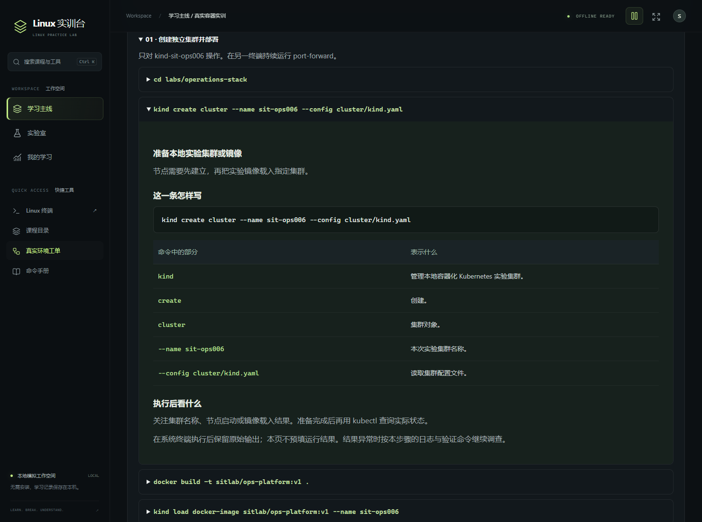

# Linux 实训台

面向计算机学生的 Linux 工作实训平台。首页从登录身份、目录权限和服务响应开始。完成共同基础验收后，可以继续接管主机、维护应用，再到真实容器中练备份恢复、监控、集群排障与容量验证。服务器 SIT 是可单独选择的专业方向。

> **浏览器模拟课完全离线。** 同页终端的命令、设备和测试结果都是模拟。另有独立的真实容器实验，命令由学员在本地 Docker 环境执行；浏览器只核对导入的证据。



## 立即开始

1. 点击仓库右上方 **Code → Download ZIP**，解压整个目录；也可以使用 `git clone https://github.com/hothihieu1976qb-netizen/server-sit-lab.git`。
2. 用 Edge 或 Chrome **双击打开 `index.html`**。保留 JS、CSS、`assets/` 等文件的目录结构；无需安装依赖、启动服务或联网。
3. 在首页点击「进入任务」，按目标在同页终端输入命令。执行后，右侧解析区会说明这条命令、实际参数、输出字段和下一步。完成操作与理解题，再进入下一步。
4. 想独立练习时，进入「实验室 → Linux 终端」；想复现问题时，进入「工作问题复现」，填写现象、环境和日志并调整模拟配置。

新学员按首页顺序练共同基础、文件日志、账号权限、软件环境及服务调度，再进入主机接管与 Web 发布。每一阶段都有自己的独立验收；已有基础的学员可以直接参加相应验收，未上的课程仍保留“未开始”。服务器 SIT 是可选方向，可以从课程目录进入。例如用以下命令采集测试环境信息：

```text
uname -a
lscpu
free -h
lsblk -f
lspci -nnk
ip -br link
ethtool enp3s0
dmesg -T
```

共同基础中还可练「服务退出后，从哪里找到原因」（`#lesson/linux-service-logs`），用状态、当前与历史日志定位配置错误，亲自修正并复测。

## 从首页按任务学习

| 阶段 | 已可操作的任务 | 阶段出口 |
|---|---|---|
| 认识系统 | 身份与版本、目录权限、服务响应、服务退出与日志 | 独立值班交接 |
| 文件与日志取证 | 定位当前文件、阅读时间范围、筛选计数、覆盖与追加保存 | 新现场的日志证据交接 |
| 账号与最小权限 | 有效身份与旧会话、目录和文件权限、获准组与反向验证 | 只读输入授权交接 |
| 软件包与运行环境 | 仓库与本机安装、包内文件、PATH、实际版本和手工产物 | 依赖与本轮运行交接 |
| 服务与定时任务 | 当前运行与开机启用、计划字段、失败派发与本轮自动产物 | 重启后的自动巡检独立交接 |
| 接管日常工作 | 巡检计划恢复、应用发布与回滚 | 带操作证据的交接报告 |
| 维护真实服务 | PostgreSQL 恢复、容器发布、监控告警 | 本地环境采集的证据核对 |
| 集群与容量专题 | Service/EndpointSlice 排障、队列与尾延迟对比 | 跨层证据与受控复测 |

这些是当前已接入任务，持续扩充的课程范围见路线图。新学员从首页进入第一项；已掌握相应基础的学员可参加阶段独立验收。跳过的课程继续保留自己的学习状态。

「文件与日志取证」从 `#lesson/linux-find-files` 开始，依次进入 `linux-read-logs`、`linux-filter-save` 与 `linux-log-handoff`。每节课有自己的模拟文件树、工作目录与操作记录。基础命令手册里的配套条目可直接进入对应课程。



模拟 Shell 支持本课用到的固定字符串筛选，以及 `grep`、`head`、`tail`、`wc` 的管道组合。`>` 与 `>>` 只写虚拟 `/tmp/文件名`。正则表达式、变量、条件执行与真实 Shell 脚本仍需后续课程和相应模型支持。

账号阶段从 `#lesson/linux-account-identity` 开始，再进入 `linux-directory-access` 和 `linux-access-handoff`。练习复用后续主机巡检中的 reportbot/hostops 名称与模型，每门课独立保存环境。`sim session` 负责在课程中打开新模拟会话；刷新继续当前会话，模拟重启重新载入组。任务中的 sudo 是课内预授权操作，目录和文件权限、主组和补充组都要按实际输出验证。



软件阶段从 `#lesson/linux-package-basics` 开始，再进入 `linux-command-path` 与 `linux-package-handoff`。练习使用固定的教学软件源和版本，支持 `rpm -ql jq`、`command -v jq`、`printenv PATH`、有限的 `export PATH=…` 与 jq 版本检查。安装与当前会话环境分别保存，巡检报告用运行编号对应本轮产物；刷新后可继续。



服务与定时任务从 `#lesson/linux-service-lifecycle` 开始，继续 `linux-cron-evidence` 和 `linux-schedule-handoff`。先观察“服务启动了但没启用”“已启用但当前停止”两种状态，再读懂系统计划的每个字段。课程会真实触发模拟失败：调度器已派发、脚本缺依赖退出 127，旧报告仍留在原处。修复后必须取得本轮新的自动结果，不能用手工报告或重新读取旧文件代替验收。





## 每一条命令怎样学

现有 **40 门同页课程、24 个 SIT 专题和 5 张真实环境工单**采用统一的学习顺序：

1. **先理解目标和概念**：解释本步所需的词，例如进程、端口、队列深度。
2. **看一个能核对的小例子**：先数三行文本，再学 `wc -l`；先算 `1000 IOPS × 4KiB ≈ 3.91MiB/s`，再读性能输出。
3. **逐条读命令**：每个命令单独选择，查看参数、参数值和输出字段说明。
4. **自己输入并执行**：命令按钮只填入终端；按 Enter 后，真实操作记录才进入本轮课程证据。
5. **用输出判断并验收**：填写读数、解释原因、核对产物，再进入下一步。

模拟输出预览读取当前课程的克隆机器，不会更改正式环境或自动完成任务。独立验收隐藏导读、命令提示和答案。真实环境课程明确说明命令在自己的系统终端执行，网页只读取导入的证据。





## 在平台里能做什么

| 工作环节 | 可操作内容 | 练习重点 |
|---|---|---|
| 环境确认 | 查看型号、CPU、内存、磁盘、网卡、驱动、系统与内核 | 区分硬件识别、模块加载、设备绑定和接口创建 |
| Linux 工作实训 | 主机日常运维与 Web 发布，两张工单共 11 步 | 重启后验证计划任务与报告；分层排查 502 并回滚；导出交接证据 |
| [真实容器实训 · OPS-003](labs/backup-restore/README.md) | Docker Compose 启动 PostgreSQL 与订单 API，另设隔离恢复环境 | 实际备份、校验、恢复；用 SQL 与 HTTP 检查数据缺口，验证脚本失败 |
| [真实容器与平台实训 · OPS-004–007](labs/operations-stack/README.md) | 订单服务、持久化卷、Prometheus、独立 kind 多节点实验 | 部署回滚、监控告警、跨节点排障、并发与容量对比 |
| 服务器 SIT 同页实训 | 20 个初级与中级案例、62 个步骤；另有专题学习路径 | 执行命令，用实际证据验收和推进 |
| Linux 终端 | 输入支持的命令并查看模拟输出、历史与执行状态 | 解析参数值、输出字段、常见误解及工作场景 |
| fio | 选择读写模式、块大小、队列深度、作业数、时长与 I/O 引擎 | 联合分析 IOPS、吞吐、平均延迟和 P95/P99；比较两组结果 |
| iperf3 | 模拟 A/B 双机，先启动服务端再测试 TCP 或 UDP | 区分协商速率与实际吞吐，观察重传、丢包和 Jitter |
| stress | 配置 CPU、内存和 sync 类 I/O worker，推进虚拟时间 | 对照 `top`、`free`、`vmstat` 与日志分析压力、OOM 和 I/O 错误 |
| 故障与回归 | 排查预置故障，或填写现场材料创建自己的模拟案例 | 保存证据、提出假设、复测修复版本并提交 Bug |
| 工程报告 | 八阶段工程任务、独立考核、Markdown 报告 | 根据实际操作标记 PASS、FAIL、BLOCKED、NOT RUN |


### 真实环境工单的讲解

五张真实工单都提供前置概念和可展开的逐条命令说明，解释 Compose、SQL、指标、集群资源与本轮证据。下图展示备份恢复和 Kubernetes 实验的操作讲解；真实执行需要按各自运行手册准备环境。





## 一个完整的练习示例

以「网卡重启后消失」为例：先用 `ip link` 确认接口现象，再用 `lspci -nnk` 判断设备是否仍被 PCI 枚举，用 `lsmod` 和 `modinfo simnic` 区分模块是否存在、是否加载，最后对照 `dmesg -T` 与 `journalctl -b -1 -k` 比较本次和上次启动。记录原因假设后，在模拟机中应用处理并重启；用原命令验证接口、链路和网络测试结果，最后把复现步骤、日志与回归结论写入 Bug 卡片。

同页实训按「读任务 → 前往终端操作 → 查看本步证据 → 提交判断」推进。证据清单会随命令更新，收齐后才可提交。课程地址包含课程编号，例如 `index.html#lesson/inventory`，可在同一浏览器中收藏，下次打开会继续这门课。

自建案例允许填写**环境、预期、故障现象、步骤与日志**，再设置网卡、路由、挂载、磁盘占用和资源负载。它适合把工作中遇到的问题抽象成一个可重复的教学实验；模拟器只覆盖已经实现的条件，不能导入任意真实日志后自动还原整台服务器。

## 可切换的教学内核

在终端或课程上方展开「模拟机 · 内核与驱动」，可选择 4.19、5.10、6.6 教学配置。选择的是**下次启动版本**；模拟重启后，再用 `uname -r`、`modinfo`、`lsmod`、`lspci -nnk`、`ip link` 和 `lsblk` 检查模块与设备。模块包按版本准备，缺包、加载失败和设备初始化失败会在命令与日志中对应出现。可以练习安装匹配包、验证和回退。


版本仅用于练习兼容性检查与证据链。平台没有真正运行 Linux 内核，也不会把版本号变化直接解释为性能提高。详细步骤和模型边界见 [模拟内核与版本实训](模拟内核与版本实训.md)。

## 学习记录与导出

进度、模拟机状态、案例、错题和项目记录保存在当前浏览器的 `localStorage`。可以在平台内导出学习档案、案例 JSON、Bug JSON、项目 JSON 和 Markdown 测试报告。清除站点数据或换一台电脑不会自动同步记录，重要练习请及时导出。

工程结论只使用当前模拟环境中的操作证据；不同内核、驱动或负载条件的旧结果保留供对照，但不能自动充当新环境的通过证据。报告中的性能数值只用于理解指标及参数关系。

从首页的「真实容器环境」可选择五张真实工单。配套脚本在系统终端读取实验服务、SQL 或集群信息，生成文件，再从网页导入核对和导出交接。网页没有安装或启动 Docker 的权限。

更多操作细节：[使用说明](使用说明.md) · [Linux 实训路线图](Linux实训路线图.md) · [中级 SIT 成长路线](中级SIT成长路线.md)。

## 项目结构

项目是原生 HTML、CSS、JavaScript 单页应用，无构建步骤。`index.html` 是入口；`guided-courses.js` 与 `extended-courses.js` 定义 SIT 课程；`host-ops-course.js` 和 `linux-work-courses.js` 定义 Linux 工单，`host-ops-lab.js`、`linux-work-lab.js` 实现对应的模拟行为；`practice-engine.js` 负责命令、会话状态与证据；`coach.js` 与 `command-teaching.js` 负责实际命令解析；`beginner-teaching.js`、`course-teaching.js`、`topic-teaching.js` 和 `real-teaching.js` 提供逐条导读、术语、小例子与真实工单讲解。`previews/` 仅存展示图片，`assets/lucide/` 存离线图标。

## 已知边界与参与改进

命令解析只覆盖页面声明的命令与常见参数，不是完整 Shell；不支持真实内核 bug 的复现、驱动认证或精确性能评测。发现命令输出不一致、课程判断有误或需要新的工作案例，欢迎提交 Issue，附上**平台内的复现步骤、模拟配置和预期/实际结果**。请勿上传真实工作环境的密码、密钥或敏感日志。

维护和贡献时，可按 [贡献指南](CONTRIBUTING.md) 选择修改入口并运行一次浏览器冒烟检查。普通学习无需安装任何开发工具。

本项目代码以 [MIT License](LICENSE) 开放。随仓库提供的 Lucide 图标遵循其自身许可，详见 [第三方资源说明](assets/THIRD-PARTY.md)。
