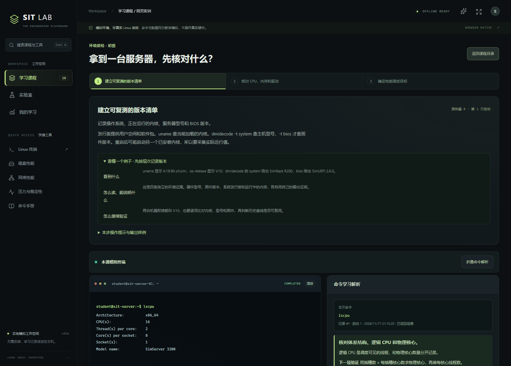
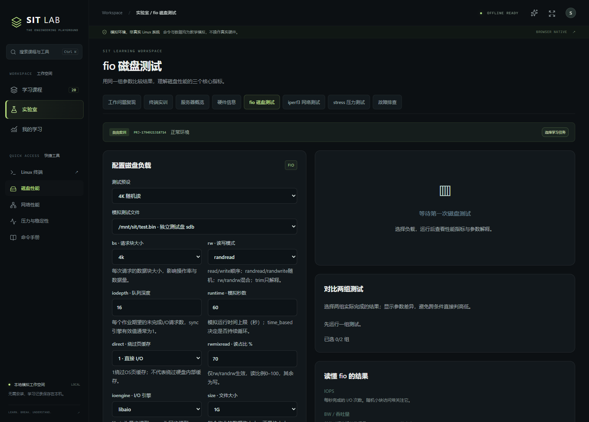
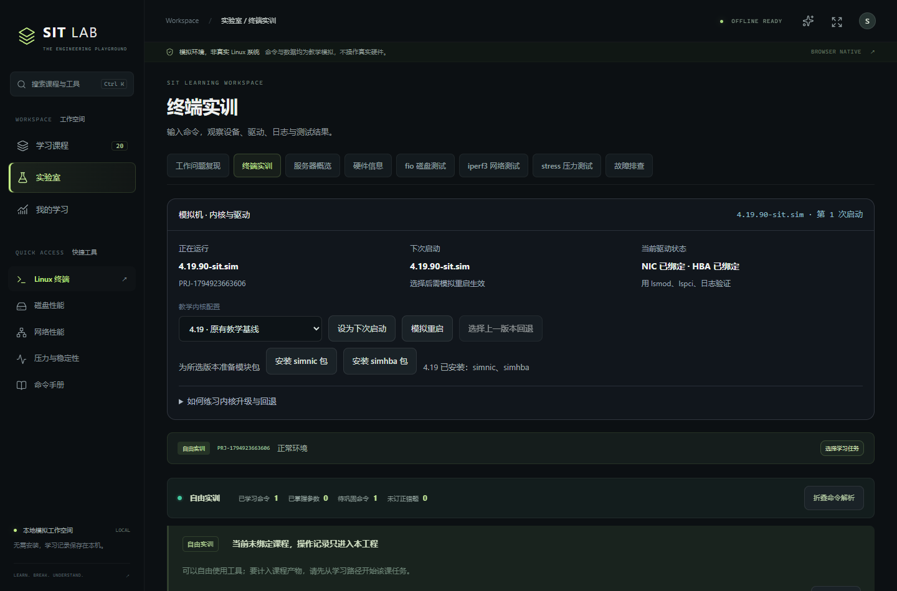

# SIT Lab · 服务器 SIT 学习与实训平台

一个完全离线、打开即用的服务器测试学习平台。它用浏览器中的模拟服务器，把环境巡检、Linux 命令、性能测试、故障定位、Bug 回归和测试报告连成一条可操作的工作流程。适合具备 Linux 基础、希望按任务练习初级到中级服务器 SIT 工作方法的读者。

> **模拟环境，非真实 Linux 系统。** 所有命令、设备、日志和测试数字均由本地 JavaScript 生成。页面不会执行系统命令，也不会占用真实服务器的 CPU、内存、磁盘或网络资源。教学内核版本和硬件型号不代表任何厂商的兼容认证。


## 立即开始

1. 点击仓库右上方 **Code → Download ZIP**，解压整个目录；也可以使用 `git clone https://github.com/hothihieu1976qb-netizen/server-sit-lab.git`。
2. 用 Edge 或 Chrome **双击打开 `index.html`**。保留 JS、CSS、`assets/` 等文件的目录结构；无需安装依赖、启动服务或联网。
3. 从「学习课程」选一个任务，按目标在同页终端输入命令。执行后，右侧解析区会说明这条命令、实际参数、输出字段和下一步。完成操作与理解题，再进入下一步。
4. 想独立练习时，进入「实验室 → Linux 终端」；想复现问题时，进入「工作问题复现」，填写现象、环境和日志并调整模拟配置。

第一次可尝试：

```text
uname -a
lscpu
free -h
lsblk -f
lspci -nnk
ip -br link
ethtool enp3s0
dmesg -T
```

## 在平台里能做什么

| 工作环节 | 可操作内容 | 练习重点 |
|---|---|---|
| 环境确认 | 查看型号、CPU、内存、磁盘、网卡、驱动、系统与内核 | 区分硬件识别、模块加载、设备绑定和接口创建 |
| 同页实训 | 20 个初级与中级案例、62 个步骤；另有专题学习路径 | 先执行命令，再根据证据判断，而不是只看教程 |
| Linux 终端 | 输入支持的命令并查看模拟输出、历史与执行状态 | 解析参数值、输出字段、常见误解及工作场景 |
| fio | 选择读写模式、块大小、队列深度、作业数、时长与 I/O 引擎 | 联合分析 IOPS、吞吐、平均延迟和 P95/P99；比较两组结果 |
| iperf3 | 模拟 A/B 双机，先启动服务端再测试 TCP 或 UDP | 区分协商速率与实际吞吐，观察重传、丢包和 Jitter |
| stress | 配置 CPU、内存和 sync 类 I/O worker，推进虚拟时间 | 对照 `top`、`free`、`vmstat` 与日志分析压力、OOM 和 I/O 错误 |
| 故障与回归 | 排查预置故障，或填写现场材料创建自己的模拟案例 | 保存证据、提出假设、复测修复版本并提交 Bug |
| 工程报告 | 八阶段工程任务、独立考核、Markdown 报告 | 根据实际操作标记 PASS、FAIL、BLOCKED、NOT RUN |





## 一个完整的练习示例

以「网卡重启后消失」为例：先用 `ip link` 确认接口现象，再用 `lspci -nnk` 判断设备是否仍被 PCI 枚举，用 `lsmod` 和 `modinfo simnic` 区分模块是否存在、是否加载，最后对照 `dmesg -T` 与 `journalctl -b -1 -k` 比较本次和上次启动。记录原因假设后，在模拟机中应用处理并重启；用原命令验证接口、链路和网络测试结果，最后把复现步骤、日志与回归结论写入 Bug 卡片。

自建案例允许填写**环境、预期、故障现象、步骤与日志**，再设置网卡、路由、挂载、磁盘占用和资源负载。它适合把工作中遇到的问题抽象成一个可重复的教学实验；模拟器只覆盖已经实现的条件，不能导入任意真实日志后自动还原整台服务器。

## 可切换的教学内核

在终端或课程上方展开「模拟机 · 内核与驱动」，可选择 4.19、5.10、6.6 教学配置。选择的是**下次启动版本**；模拟重启后，再用 `uname -r`、`modinfo`、`lsmod`、`lspci -nnk`、`ip link` 和 `lsblk` 检查模块与设备。模块包按版本准备，缺包、加载失败和设备初始化失败会在命令与日志中对应出现。可以练习安装匹配包、验证和回退。



版本仅用于练习兼容性检查与证据链。平台没有真正运行 Linux 内核，也不会把版本号变化直接解释为性能提高。详细步骤和模型边界见 [模拟内核与版本实训](模拟内核与版本实训.md)。

## 学习记录与导出

进度、模拟机状态、案例、错题和项目记录保存在当前浏览器的 `localStorage`。可以在平台内导出学习档案、案例 JSON、Bug JSON、项目 JSON 和 Markdown 测试报告。清除站点数据或换一台电脑不会自动同步记录，重要练习请及时导出。

工程结论只使用当前模拟环境中的操作证据；不同内核、驱动或负载条件的旧结果保留供对照，但不能自动充当新环境的通过证据。报告中的性能数值只用于理解指标及参数关系。

更多操作细节：[使用说明](使用说明.md) · [中级 SIT 成长路线](中级SIT成长路线.md)。

## 项目结构

项目是原生 HTML、CSS、JavaScript 单页应用，无构建步骤。`index.html` 是入口；`guided-courses.js` 与 `extended-courses.js` 定义课程；`practice-engine.js`、`kernel-model.js`、`network-lab.js`、`system-lab.js` 和 `host-lab.js` 负责模拟行为；`engine-bridge.js` 让原有综合实验室共用模型；`coach.js` 与 `command-teaching.js` 负责命令学习；`training.js` 生成工程与报告。`previews/` 仅存展示图片，`assets/lucide/` 存离线图标。

## 已知边界与参与改进

命令解析只覆盖页面声明的命令与常见参数，不是完整 Shell；不支持真实内核 bug 的复现、驱动认证或精确性能评测。发现命令输出不一致、课程判断有误或需要新的工作案例，欢迎提交 Issue，附上**平台内的复现步骤、模拟配置和预期/实际结果**。请勿上传真实工作环境的密码、密钥或敏感日志。

本项目代码以 [MIT License](LICENSE) 开放。随仓库提供的 Lucide 图标遵循其自身许可，详见 [第三方资源说明](assets/THIRD-PARTY.md)。
